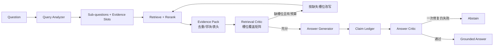

# FinResearch Agentic RAG V2

## 项目边界

V2 仍是一个受控的单 Agent 研究循环，不包装成多 Agent。它只解决一件事：在有限预算内找到足够证据，并证明最终每条结论都由证据支持。



## 可观测状态

- `QueryPlan`：route、sub-questions、evidence slots、依赖、公司/年份/指标过滤条件。
- `EvidenceItem`：来源查询、检索轮次、页码、section、相邻关系、覆盖槽位和不可信指令标记。
- `VerificationDecision`：槽位覆盖矩阵、冲突、缺失证据和 follow-up query。
- `AgentTrace`：每轮新增证据、上下文 Token 估算、继续/停止原因。
- `Claim`：原子结论、年份、数值、单位、引用、支持状态和问题。

## 关键实现

| 模块 | 作用 |
|---|---|
| `query_analysis.py` | 区分 single fact、同段多槽位、跨章节多跳和跨公司比较 |
| `evidence.py` | 构建 Evidence Pack，在块数与 Token 预算内扩展前后块 |
| `retrieval_critic.py` | 确定性槽位覆盖检查；与模型判断采用 fail-closed 合并 |
| `answer_critic.py` | 逐字引用、原子 claim、公司/年份/指标/数值/单位一致性 |
| `budgets.py` | 检索轮数、子查询、证据块、上下文、LLM 调用和修复次数硬上限 |
| `evaluation_v2.py` | 类别 Macro-F1、槽位/完整证据、二轮增益、claim/citation、拒答、延迟与成本 |

旧语料没有显式 `prev_chunk_id`/`next_chunk_id` 时，V2 在加载时按同一 `document_id` 的稳定顺序推导；新生成 chunk 会直接写入这两个字段。邻块扩展默认最多 2 块，且仍受总块数和上下文 Token 预算约束。

## 终止与安全

1. 第二轮查询只能来自缺失证据槽位或 verifier 明确给出的 follow-up。
2. 第二轮没有新增文档时立即停止，不再消耗 verifier 调用。
3. 任一硬预算耗尽都返回 `budget_exceeded:*`，不带猜测答案。
4. 文档内容被当作不可信数据；除 prompt 约束外，证据构建器会标记常见注入模式，Retrieval Critic 以 fail-closed 方式阻断。
5. 引用存在但数值、单位、年份、公司或指标不一致时，Answer Critic 判失败。
6. 答案最多修复一次，仍失败则拒答。

## 运行

```bash
PYTHONPATH=src .venv/bin/python -m finresearch.agent_cli \
  "比较比亚迪和宁德时代2024年营业收入" \
  --documents data/processed/byd_2024_chunks_v3.jsonl \
              data/processed/catl_2024_chunks_v3.jsonl \
  --retriever bm25-rerank --max-iterations 2 \
  --max-evidence-chunks 12 --max-context-tokens 8000 \
  --max-llm-calls 8 --max-neighbor-chunks 2
```

输出包含 route、每轮 query、slot coverage、follow-up、显式 claim-to-citation ledger、引用、检索/验证耗时、LLM 调用数和 Token 使用。

只看证据链路的本地 Demo：

```bash
.venv/bin/python -m finresearch.web_demo --port 8766
```
