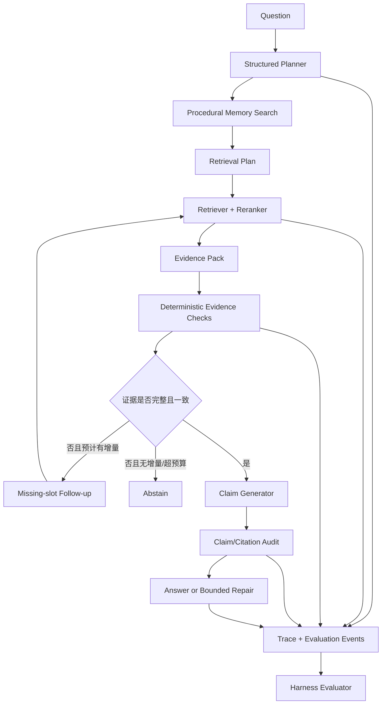

# FinResearch Agent：Eval-Driven Harness 升级计划

> 状态：核心本地闭环、V3 dev/held-out/frozen、F0—F4、Langfuse v4 SDK 契约已于 2026-10-25 实现；F5 本地 Evo-Harness Context-to-Harness 演化于 2026-10-26 完成并通过 dev/held-out 门禁。  
> 实现边界和真实验证见 [`UPGRADE_IMPLEMENTATION_V3.md`](UPGRADE_IMPLEMENTATION_V3.md)。  
> 基线日期：2026-10-25。  
> 原则：V1/V2 冻结集和结果永久保留；新设计只能在新建开发集上迭代，完成后另建 V3 冻结集。

## 1. 升级目标

FinResearch 下一阶段不再以“继续提高检索 Recall”作为主叙事，而是升级为：

> **面向金融事实核查的 Eval-Driven Research Agent：通过结构化任务规划、证据充分性评测、程序性记忆和受控 Harness 迭代，提高端到端严格成功率，并控制错误引用、过度拒答和无效推理成本。**

项目保留 BM25、Dense、RRF 和 Cross-Encoder，因为它们仍是证据系统的基础；但检索指标降为诊断指标，最终决策以任务级评测为准。

## 2. 当前真实基线

以下数字来自 `docs/FROZEN_EVAL_V2.md`，不是目标值：

| 能力 | 当前结果 | 结论 |
|---|---:|---|
| R2 Retrieval Complete Evidence | 88.28% | 检索已不是唯一瓶颈 |
| R3 Route Accuracy | 54.05% | 路由和任务理解是主要上限 |
| R3 Strict Success | 25.68% | 检索命中没有稳定转化为完成任务 |
| R4 二轮增量召回 | 1.35% | 当前 follow-up query 收益很低 |
| R4 无效二轮率 | 72.97% | 需要跳过低价值第二轮 |
| R5 Strict Success | 18.92% | Answer Critic 导致明显过度拒答 |

升级时不得覆盖这些负结果，也不得用开发集数字替换冻结结果。

## 3. 非目标

- 不为了展示框架而改造成多 Agent 系统。
- 不继续无目的叠加 Retriever、Embedding 或更大 Top-K。
- 不把容易过期的财务数值写成无期限长期记忆。
- 不允许 RSI/Harness 优化读取 V2/V3 冻结答案或评分规则。
- 不以 LLM-as-a-Judge 单一分数替代可执行证据检查。
- 不把 Langfuse、Mem0 或其他依赖名称当作项目贡献本身。

## 4. 目标架构



核心变化有四个：

1. Router 从单标签分类升级为结构化任务计划。
2. 长期记忆只保存可复用的研究策略和失败经验。
3. 二次检索必须先预测增量价值。
4. Harness 修改必须由隔离评测决定是否晋级。

## 5. 结构化 Planner

### 5.1 输出 Schema

建议新增 `ResearchPlan`：

```json
{
  "answerability": "unknown",
  "route": "cross_company_compare",
  "entities": ["BYD", "CATL"],
  "periods": ["2024"],
  "evidence_slots": [
    {
      "slot_id": "byd_revenue_2024",
      "company": "BYD",
      "metric": "revenue",
      "period": "2024",
      "unit_policy": "normalize"
    },
    {
      "slot_id": "catl_revenue_2024",
      "company": "CATL",
      "metric": "revenue",
      "period": "2024",
      "unit_policy": "normalize"
    }
  ],
  "dependencies": [],
  "retrieval_queries": []
}
```

### 5.2 评测方式

Planner 不只评测 `route`，还需分别评测：

- Entity Precision/Recall；
- Period Accuracy；
- Evidence Slot Coverage；
- Dependency Accuracy；
- Answerability Accuracy；
- Same-section 误判为 multi-hop 的比例。

只有 Planner 的结构化字段通过检查后，才进入后续检索。

## 6. 程序性长期记忆

### 6.1 允许写入的内容

- 某类问题有效的 query decomposition 模式；
- 某类表格需要标题、表头或相邻块的经验；
- 某类查询曾导致跨公司证据缺一端；
- 某种 critic 规则曾产生过度拒答；
- 某类任务在哪个预算下收益开始饱和；
- 已验证的失败策略及其适用边界。

### 6.2 禁止作为长期真相写入的内容

- 未绑定公司、报告期、文档版本的财务数值；
- Agent 自己生成但未经证据验证的结论；
- 冻结测试集题目、gold evidence 或评分器细节；
- 文档中的指令性内容；
- 无来源、无时间戳或无适用范围的经验。

### 6.3 记忆 Schema

```text
ResearchMemory
  memory_id
  memory_type: procedural | negative_experience
  task_signature
  content
  applies_to
  source_trace_ids[]
  evidence_count
  confidence
  created_at
  valid_from / valid_to
  supersedes[]
  status: active | disputed | expired
```

### 6.4 Add 流程

```text
成功或失败 Trace
→ 抽取候选经验
→ 去除具体测试题与答案
→ 与已有经验做重复/冲突判断
→ 要求最少证据次数
→ 版本化写入或标记 disputed
```

### 6.5 Search 流程

```text
ResearchPlan
→ task_signature 过滤
→ semantic + keyword 召回
→ 按适用范围、来源数量、时效和置信度重排
→ 返回少量策略，不返回答案事实
```

必须评测“召回记忆后是否提高任务成功率”，不能只报告 Memory Recall@K。

## 7. 增量检索 Gate

在第二轮检索前新增 `RetrievalValueGate`，输入：

- 当前缺失槽位；
- 第一轮候选集和排序分布；
- 已使用 query；
- 程序性记忆；
- 剩余 Token/调用预算。

输出：

```json
{
  "should_retry": true,
  "expected_missing_slots": ["catl_revenue_2024"],
  "query_delta": "限定公司、年份和报表指标",
  "stop_reason": null
}
```

硬规则：

- follow-up 必须对应缺失槽位；
- 与上一轮 query 近似重复时停止；
- 候选集饱和且无新增实体/年份约束时停止；
- 最大轮数继续受硬预算控制；
- Gate 的误判和节省成本必须单独报告。

## 8. Trace 与 Langfuse 接入

先定义本地、可重放的 `TraceEvent`，Langfuse 只作为可选 Sink：

```text
trace_id
run_id
dataset_split
harness_version
stage
input_refs
output_summary
latency_ms
token_usage
model
error_code
evaluation_scores
```

必须记录：

- Planner 原始输出和校验结果；
- 每条 query、候选和 rerank 结果；
- Evidence Slot Coverage；
- 第二轮是否带来新证据；
- 每个 claim 与 citation 的绑定；
- 拒答原因；
- Harness 版本和 Prompt 哈希。

隐私边界：默认只发送文档 ID、页码、脱敏摘要和分数；原始年报全文不进入第三方观测服务。自托管时也保留配置开关。

## 9. Harness 组件与 RSI-lite

### 9.1 第一阶段允许修改的组件

- Planner Prompt；
- Route/Answerability 规则；
- Tool Guidance；
- Procedural Memory Write/Search Policy；
- RetrievalValueGate 阈值；
- Critic 校准参数；
- Token 和调用预算。

不允许自动修改：

- 冻结数据；
- gold evidence；
- 评分器；
- 权限和安全边界；
- 文档下载与哈希校验逻辑。

### 9.2 候选迭代流程

```text
分析 Dev Bad Cases
→ 提出单一、可解释假设
→ 生成结构化 Harness diff
→ 泄漏与静态安全检查
→ Smoke Eval
→ Dev 重复运行
→ 成本/质量联合选择
→ Held-out 验证
→ 接受或回滚
```

每次迭代写入 JSONL Ledger：

```text
candidate_id
parent_version
component
hypothesis
diff_summary
dev_delta
heldout_delta
latency_delta
token_delta
regressions[]
decision
```

## 10. 数据隔离

| 数据集 | 用途 | Harness 是否可见 |
|---|---|---|
| `dev_v3` | 生成假设、调试和候选选择 | 是 |
| `heldout_v3` | 判断候选是否泛化 | 只能运行，不能读取 gold 生成修改 |
| `frozen_v3` | 最终一次性验收 | 否；冻结前不得使用 |
| V1/V2 frozen | 历史可比性与回归报告 | 不用于新一轮自动优化 |

必须保存 manifest、SHA-256、题型分布、语义重合检查和运行配置。

## 11. 实验矩阵

| 组别 | 配置 | 要回答的问题 |
|---|---|---|
| F0 | 当前 R3 Harness | 新实验的可比基线 |
| F1 | F0 + Structured Planner | 路由与槽位是否改善 |
| F2 | F1 + RetrievalValueGate | 能否减少无效二轮 |
| F3 | F2 + Procedural Memory | 跨任务经验是否有净收益 |
| F4 | F3 + 校准后的 Claim/Citation Audit | 是否减少过度拒答 |
| F5 | F4 + RSI-lite Harness Iteration | 自动迭代能否在 held-out 泛化 |

所有组使用相同模型、温度、语料、Top-K 和预算上限。若某组失败，保留失败结果。

## 12. 主指标

### 最终指标

- Strict Task Success；
- Complete Evidence Rate；
- Claim Support Rate；
- Citation Precision/Recall；
- Abstention Precision/Recall/F1；
- Cost per Successful Task；
- Mean/P95 latency；
- Regression Rate。

### 诊断指标

- Recall@K、MRR、NDCG；
- Route Macro-F1；
- Evidence Slot Coverage；
- 二轮增量召回；
- 无效二轮率；
- Harmful Memory Rate；
- Memory Utilization Rate。

## 13. 文件级实施计划

建议新增：

```text
src/finresearch/
├── planner.py
├── trace_events.py
├── observability.py
├── procedural_memory.py
├── memory_policy.py
├── retrieval_value_gate.py
├── harness_config.py
├── harness_eval.py
└── harness_ledger.py

data/eval/v3/
├── dev_v3.jsonl
├── heldout_v3.jsonl
├── frozen_v3.jsonl
└── manifest.json

results/v3/
├── harness_ablation.json
├── memory_ablation.json
├── bad_cases.json
└── run_ledger.jsonl
```

建议修改：

- `agent.py`：使用 `ResearchPlan` 和增量检索 Gate；
- `agent_schemas.py`：新增结构化计划和 Trace schema；
- `query_analysis.py`：保留兼容层，逐步迁移到 Planner；
- `evidence.py`：记录 memory/harness 来源，不改变原始文档证据定义；
- `agent_evaluation.py`：新增规划、记忆和回归指标；
- `web_demo.py`：展示 Harness 版本、记忆命中和停止原因。

## 14. 测试要求

至少覆盖：

- Planner schema 非法输出 fail-closed；
- same-section 不被机械判为 multi-hop；
- 程序性记忆不能包含冻结答案；
- 过期/争议记忆不能静默成为唯一依据；
- 相似 follow-up query 被 Gate 阻止；
- 第二轮新增证据被正确归因；
- Claim/Citation Audit 不因单个不确定字段拒绝全部可回答内容；
- Harness 候选不能修改评分器和数据；
- Trace 不泄漏原始全文；
- 固定随机种子和重复运行结果可复现。

## 15. 验收标准

写入简历前必须同时满足：

- 一键运行 F0—F5；
- 隔离的 dev/held-out/frozen 数据；
- 至少三组可解释消融；
- 只报告真实运行数字；
- 至少 10 个 Agent Bad Case 及根因分类；
- 每次 Harness 修改有可审计 Ledger；
- 报告记忆带来的正收益和负迁移；
- README、架构图、运行日志和 Demo 同步更新；
- 能完成 5 分钟陈述和三层追问。

## 16. 推荐实施顺序

1. Trace schema 与本地 JSONL sink；
2. Structured Planner 与字段级评测；
3. RetrievalValueGate；
4. 程序性记忆及冲突/过期处理；
5. F0—F4 手工消融；
6. 接入 Langfuse 可视化；
7. 对接 EvoHarness，完成 F5；
8. 冻结 V3，生成 Bad Case 和面试材料。

